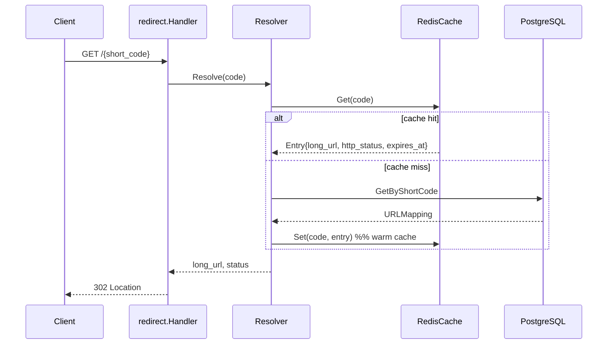

# Architecture Notes

Narrative companion to the diagrams in the top-level README. Status: **Phase 3
scale core + frontend** implemented; analytics pipeline (Phase 4) not started.

## Components

```mermaid
flowchart TB
    subgraph Clients
        Browser[Browser / API clients]
        Dashboard[React Dashboard]
    end

    subgraph Edge
        Web["web (nginx + SPA)"]
    end

    subgraph App["Application Layer (Go, cmd/api)"]
        Mux[server router + middleware]
        API[shorten.Handler]
        RED[redirect.Handler]
        DEL[links.Handler]
    end

    subgraph Cache
        Redis[(Redis)]
    end

    subgraph Storage
        PG[(PostgreSQL)]
    end

    Browser --> Mux
    Dashboard --> Web
    Web --> Mux
    Mux -->|POST /api/v1/shorten| API
    Mux -->|GET /{code}| RED
    Mux -->|DELETE /api/v1/links/{code}| DEL

    API --> Redis
    API --> PG
    RED --> Redis
    RED --> PG
    API --> Metrics[Prometheus /metrics]
    RED --> Metrics
```

Solid rectangles are implemented today. The Kafka → consumer → ClickHouse path
from the README is deliberately absent here until Phase 4 — the redirect hot path
currently has **no analytics side effects**.

## Redirect path (read-through cache)



Cache behaviour: **warm on create**, **read-through on miss**, **invalidate on
delete**, and **fail-open** (`NoopCache`) when Redis is down. See ADR
[0005](../adr/0005-fail-open-vs-fail-closed-on-redis-outage.md).

## Middleware order

```
metrics.Middleware → requestLogger → mux
```

Per-route chains (composed in `cmd/api/main.go`):

```
POST   /api/v1/shorten          → ratelimit(fixed window) → auth.Optional → shorten.Handler
GET    /{short_code}            → ratelimit(token bucket) → redirect.Handler
DELETE /api/v1/links/{code}     → auth.Required           → links.Handler
```

## Package map

| Package | Responsibility |
|---------|----------------|
| `internal/server` | Router, health/ready/metrics wiring |
| `internal/shorten` | Create link, cache warm |
| `internal/redirect` | Resolve + 302 (read-through resolver) |
| `internal/links` | Ownership-checked soft delete |
| `internal/cache` | `URLCache` interface, Redis impl, `NoopCache` |
| `internal/ratelimit` | Fixed window + token bucket + middleware |
| `internal/auth` | HS256 JWT issue/parse + middleware |
| `internal/storage` | Postgres repository |
| `internal/idgen` | Snowflake + sequence generators |
| `internal/metrics` | Prometheus counters/histograms |
| `internal/cors` | Frontend origin allowlist |

## Open questions

- Analytics pipeline shape (Phase 4) — see ADR
  [0003](../adr/0003-clickhouse-vs-postgres-for-analytics.md).
- Sharding strategy and when it is actually needed — see ADR
  [0002](../adr/0002-hash-sharding-vs-range-sharding.md).
