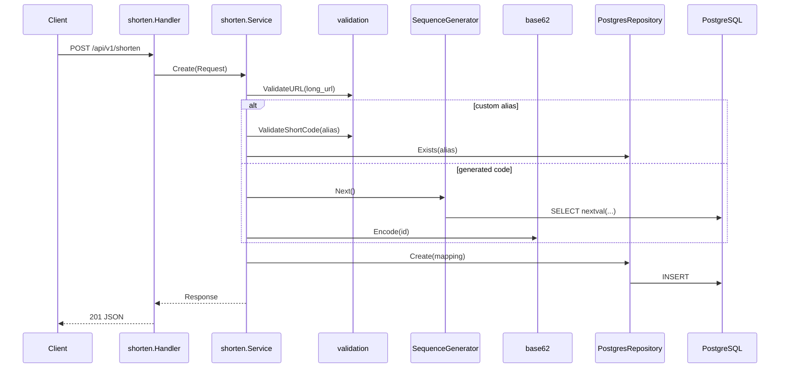
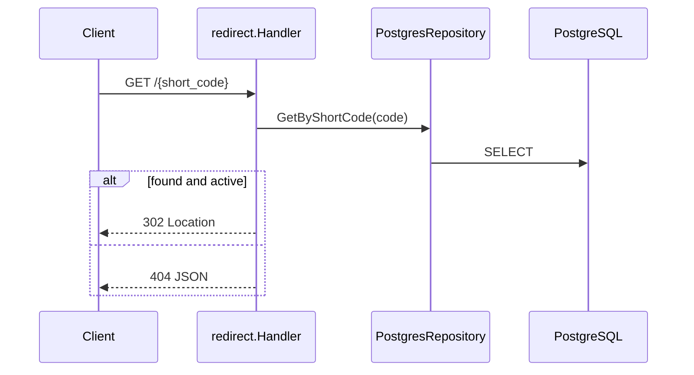

# Phase 2 Implementation Log — MVP Core Shortener

**Roadmap:** `roadmap/phases/02-mvp-core-shortener.md`  
**Git commit:** `cf3cfad` — *Implement Phase 2 MVP shortener with shorten, redirect, and per-service logging.*  
**Date:** 2026-06-28

---

## Goal

Smallest end-to-end product: accept a long URL, store a mapping, return a short URL, and redirect `GET /{short_code}` with HTTP 302.

---

## What was delivered

| Deliverable | Status |
|-------------|--------|
| Base62 encode/decode | Done |
| ID generation (Postgres sequence) | Done |
| `POST /api/v1/shorten` | Done |
| `GET /{short_code}` → 302 | Done |
| URL + alias validation | Done |
| Structured JSON errors (`400`, `404`, `409`) | Done |
| Postgres repository | Done |
| Unit tests (base62, shorten, redirect, validation) | Done |
| Postman collection + demo script | Done |
| Per-service file logging (api, postgres, migrate) | Done |

---

## API surface (new in Phase 2)

### `POST /api/v1/shorten`

**Request:**

```json
{
  "long_url": "https://example.com/path",
  "custom_alias": "optional",
  "expires_in_seconds": 3600
}
```

**Success (201):**

```json
{
  "short_code": "RSBasaKaxG",
  "short_url": "http://localhost:8080/RSBasaKaxG",
  "long_url": "https://example.com/path",
  "expires_at": "2026-07-07T12:00:00Z"
}
```

**Errors:**

| HTTP | Code | When |
|------|------|------|
| 400 | `INVALID_JSON` | Malformed body |
| 400 | `INVALID_URL` | Not http/https, empty, localhost, private IP |
| 400 | `INVALID_ALIAS` | Alias fails `^[a-zA-Z0-9_-]{3,16}$` |
| 409 | `ALIAS_TAKEN` | Custom alias already exists |
| 500 | `INTERNAL_ERROR` | Unexpected DB/other failure |

### `GET /{short_code}`

**Success:** `302 Found` with `Location: <long_url>`.

**Errors:**

| HTTP | Code | When |
|------|------|------|
| 404 | `NOT_FOUND` | Unknown code, inactive link, or expired |
| 500 | `INTERNAL_ERROR` | DB failure |

---

## Architecture (Phase 2)





---

## New packages and files

### `internal/encoding/base62/`

| File | Purpose |
|------|---------|
| `base62.go` | `Encode(uint64) string`, `Decode(string) (uint64, error)` |
| `base62_test.go` | Round-trip, edge cases (`0` → `"0"`, invalid chars) |

**Alphabet:** `0-9a-zA-Z` (62 symbols).

**Why base62:** URL-safe, compact representation of numeric IDs. A 64-bit Snowflake/sequence ID encodes to ~11 characters.

---

### `internal/idgen/`

| File | Purpose |
|------|---------|
| `idgen.go` | `Generator` interface: `Next(ctx) (uint64, error)` |
| `sequence.go` | `SequenceGenerator` — calls `nextval('url_mapping_id_seq')` |

**Phase 2 choice:** Postgres sequence (simple, correct under concurrency, good for single-node MVP).

**Phase 3 change:** Production wiring switched to `SnowflakeGenerator` (see Phase 3 doc). `SequenceGenerator` remains in codebase for tests/fallback.

**Migration `002_url_mapping_id_seq.up.sql`:**

```sql
CREATE SEQUENCE IF NOT EXISTS url_mapping_id_seq START 1;
```

---

### `internal/validation/url.go`

**`ValidateURL(raw string) (string, error)`**

- Trims whitespace.
- Allows only `http` / `https`.
- Rejects empty host.
- **SSRF guard:** blocks localhost, `.localhost`, private/link-local IPs.

**`ValidateShortCode(code string) error`**

- Pattern: `^[a-zA-Z0-9_-]{3,16}$`.

**Tests:** `url_test.go`.

---

### `internal/storage/`

| File | Purpose |
|------|---------|
| `repository.go` | `URLMapping` struct + `Repository` interface |
| `postgres.go` | `PostgresRepository` implementation |

**`URLMapping` fields:**

```go
type URLMapping struct {
    ShortCode   string
    LongURL     string
    SnowflakeID *int64   // set for generated codes; NULL for custom alias
    UserID      *string   // NULL in Phase 2 (no auth yet)
    CreatedAt   time.Time
    ExpiresAt   *time.Time
    IsActive    bool
    HTTPStatus  int       // default 302
}
```

**`Repository` methods (Phase 2):**

| Method | SQL behavior |
|--------|--------------|
| `Create` | `INSERT`; maps `23505` unique violation → `ErrAlreadyExists` |
| `GetByShortCode` | `SELECT` by PK; no rows → `ErrNotFound` |
| `Exists` | `SELECT EXISTS(...)` |

---

### `internal/shorten/`

**Layering:** Handler (HTTP) → Service (business logic) → Repository (DB).

| File | Role |
|------|------|
| `handler.go` | JSON decode/encode, maps service errors to HTTP status |
| `service.go` | Create flow: validate → ID or alias → insert → build response |
| `handler_test.go` | HTTP-level tests with mock repo |
| `service_test.go` | Service tests: generated code, alias, taken alias, invalid URL, expiry |

**`shorten.Service.Create` logic:**

1. Validate and normalize long URL.
2. **Custom alias path:** validate format → `Exists` check → use alias as `short_code` (no `snowflake_id`).
3. **Generated path:** `idgen.Next()` → `base62.Encode(id)` → store `snowflake_id`.
4. Optional `expires_in_seconds` → `expires_at` timestamp.
5. `repo.Create` with `IsActive: true`, `HTTPStatus: 302`.
6. Return `short_url` as `{BASE_URL}/{short_code}`.

---

### `internal/redirect/`

| File | Role |
|------|------|
| `handler.go` | Extract `short_code` from path → lookup → `http.Redirect` |
| `handler_test.go` | Success 302, not found 404, expired 404 |

**Phase 2:** Handler talked to `storage.Repository` directly.

**Phase 3 refactor:** Handler delegates to `Resolver` (cache + DB). See Phase 3 doc.

**Expiry / inactive handling:**

- `!mapping.IsActive` → 404
- `expires_at` in the past → 404

---

### `internal/httpx/response.go`

Shared JSON helpers for all handlers:

```go
WriteJSON(w, status, payload)
WriteError(w, status, code, message)  // {"error":"...", "code":"..."}
```

---

### `internal/logging/` (Phase 2 additions)

| File | Role |
|------|------|
| `file.go` | Open append-only log file under `LOG_DIR` |
| `multi_handler.go` | Fan-out to console + file handlers |
| `setup_test.go` | Setup tests |

**Important fix:** File handler uses **plain text** (no ANSI). Console uses **colored** output in dev. Prevents garbled escape codes in IDE log viewers.

**Log locations (Docker):**

| Service | Host path |
|---------|-----------|
| API | `logs/api/app.log` |
| Postgres | `logs/postgres/postgres.log` |
| Migrate | `logs/migrate/migrate.log` |

**Scripts:** `scripts/tail-logs.sh` + Makefile `logs-*` / `logs-tail-*` targets.

---

### `cmd/api/main.go` (Phase 2 wiring)

Added:

1. `pgxpool.New(cfg.DatabaseURL)` + ping on startup.
2. `storage.NewPostgresRepository(pool)`.
3. `idgen.NewSequenceGenerator(pool)`.
4. `shorten.NewService(repo, generator, cfg.BaseURL)`.
5. Pass handlers to `server.Options{Shorten, Redirect}`.

---

### `internal/server/server.go` (Phase 2 routes)

```go
mux.HandleFunc("POST /api/v1/shorten", opts.Shorten.Create)
mux.HandleFunc("GET /{short_code}", opts.Redirect.Serve)
```

Catch-all `GET /{short_code}` must be registered **after** static routes like `/health` so it does not shadow them.

---

### `internal/config/config.go` (Phase 2)

Added:

| Field | Env | Default |
|-------|-----|---------|
| `BaseURL` | `BASE_URL` | `http://localhost:8080` |

Used to build `short_url` in API responses.

---

## Database

No schema change beyond migration `002` (sequence). Table from Phase 1 is used as-is.

**Example row (generated code):**

| short_code | long_url | snowflake_id | user_id |
|------------|----------|--------------|---------|
| `RSBasaKaxG` | `https://example.com/...` | `729386846206824448` | NULL |

**Example row (custom alias):**

| short_code | snowflake_id |
|------------|--------------|
| `my-demo-link` | NULL |

---

## Docker / deploy changes

**`deploy/docker-compose.yml`:**

- Postgres logging to `logs/postgres/` via `logging_collector`.
- Migrate writes to `logs/migrate/migrate.log`.
- API volume mount: `logs/api:/app/logs`.
- API env: `BASE_URL`, `LOG_DIR`, `LOG_FILE`.

---

## Tooling and docs

| Asset | Purpose |
|-------|---------|
| `scripts/demo-shorten.sh` | E2E: create link → `curl -I` redirect |
| `postman/NexusLink.local.postman_collection.json` | Health, shorten variants, redirect tests |
| `postman/NexusLink.local.postman_environment.json` | `base_host`, `short_code`, etc. |
| `Makefile` | `demo`, log tail targets |

**Postman tip:** Disable auto-follow redirects to see `302` + `Location` header.

---

## Dependencies added (Phase 2)

```
github.com/jackc/pgx/v5 v5.6.0
```

---

## Tests added (Phase 2)

| Package | Tests |
|---------|-------|
| `internal/encoding/base62` | Encode/decode |
| `internal/validation` | URL rules, alias format |
| `internal/shorten` | Service + handler |
| `internal/redirect` | Handler redirect/not found/expired |
| `internal/logging` | Setup, handler output |

Run: `go test ./...`

---

## Key design decisions (Phase 2)

| Decision | Rationale |
|----------|-----------|
| **Sequence ID first** | Simplest correct ID source for single Postgres; Snowflake-ready via `Generator` interface |
| **`snowflake_id` NULL for aliases** | Custom codes are user-chosen; no internal numeric ID needed |
| **302 not 301** | Allows re-validation on each click; better for analytics later |
| **Handler → Service → Repo** | Thin HTTP layer; business logic testable without `httptest` for every case |
| **SSRF URL validation** | Block shortening `localhost` / RFC1918 targets |
| **Plain-text file logs** | IDE-friendly; color only on terminal |

---

## How to verify Phase 2

```bash
make docker-up
make demo
# Creates short link, prints 302 headers

# Manual:
curl -X POST http://localhost:8080/api/v1/shorten \
  -H 'Content-Type: application/json' \
  -d '{"long_url":"https://example.com/hello"}'

curl -I http://localhost:8080/<short_code>
# Expect: HTTP/1.1 302 Found
#         Location: https://example.com/hello
```

**Exit criteria met:**

- Shorten + redirect works in browser or curl.
- `make demo` script documents the flow.
- Unit tests pass.

---

## Phase 2 → Phase 3 handoff

Phase 2 left these intentionally for Phase 3:

- No Redis cache (every redirect hits Postgres)
- No rate limiting
- No JWT / link ownership
- No Prometheus metrics
- No `DELETE` endpoint
- `SequenceGenerator` in production (not Snowflake yet)
- `user_id` column unused
