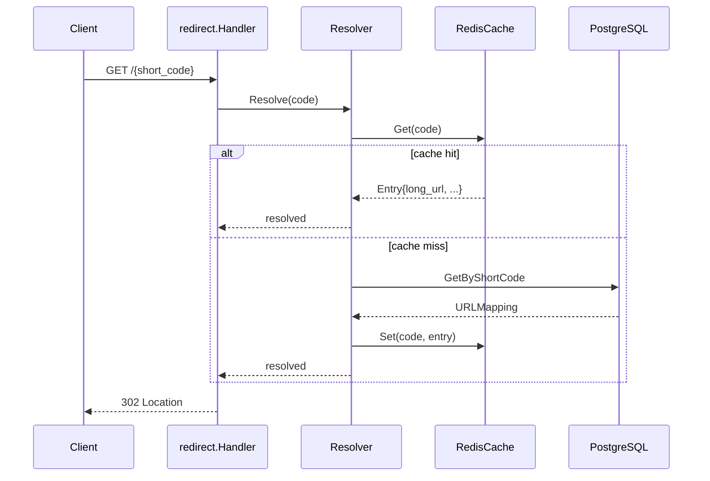

# Phase 3 Implementation Log — Scale Core (Cache, Rate Limit, Auth)

**Roadmap:** `roadmap/phases/03-scale-core-cache-rate-limit.md`  
**Git commit:** *(uncommitted at time of writing — builds on `cf3cfad`)*  
**E2E verified:** `make e2e` — all checks passed

---

## Goal

Make the MVP production-like: faster redirect reads via Redis, abuse protection via rate limits, user-owned links via JWT, and observability via Prometheus metrics.

---

## What was delivered

| Deliverable | Status |
|-------------|--------|
| Redis redirect cache (read-through) | Done |
| Cache warm on shorten, invalidate on delete | Done |
| Fail-open when Redis unavailable | Done |
| Fixed-window rate limit (shorten) | Done |
| Token-bucket rate limit (redirect) | Done |
| JWT auth + `DELETE /api/v1/links/{short_code}` | Done |
| Optional JWT on shorten (stores `user_id`) | Done |
| Snowflake ID generator (production default) | Done |
| Prometheus metrics + `GET /metrics` | Done |
| Readiness probe `GET /ready` | Done |
| Redis in Docker Compose | Done |
| `cmd/gentoken` dev utility | Done |
| E2E test script | Done |
| Migration `003_user_id_text` | Done |

---

## API surface (new/changed in Phase 3)

### New endpoints

| Method | Path | Auth | Purpose |
|--------|------|------|---------|
| `GET` | `/ready` | None | Readiness: Postgres + Redis ping |
| `GET` | `/metrics` | None | Prometheus text exposition |
| `DELETE` | `/api/v1/links/{short_code}` | **Required** JWT | Soft-delete owned link |

### Changed endpoints

| Method | Path | Phase 3 change |
|--------|------|----------------|
| `POST` | `/api/v1/shorten` | Rate limited; optional `Authorization: Bearer` stores `user_id` |
| `GET` | `/{short_code}` | Rate limited; resolves via Redis cache first |

### `DELETE /api/v1/links/{short_code}`

**Headers:** `Authorization: Bearer <jwt>`

**Success:** `204 No Content`

**Errors:**

| HTTP | Code | When |
|------|------|------|
| 401 | `UNAUTHORIZED` | Missing/invalid JWT |
| 403 | `FORBIDDEN` | Link owned by another user |
| 403 | `FORBIDDEN` | Anonymous link (`user_id` NULL) — message: *anonymous links cannot be deleted* |
| 404 | `NOT_FOUND` | Unknown or already deactivated |
| 429 | `RATE_LIMITED` | *(not on delete in current wiring)* |

### `GET /ready`

**Success (200):**

```json
{"status":"ready"}
```

**Failure (503):**

```json
{"status":"not_ready","error":"database: ..." }
```

### Rate limit response (429)

```json
{"error":"rate limit exceeded","code":"RATE_LIMITED"}
```

Applies to shorten and redirect paths when limits exceeded.

---

## Architecture overview (Phase 3)

```mermaid
flowchart TB
    subgraph Middleware["Per-route middleware (main.go)"]
        RL[ratelimit.Middleware]
        AUTH_OPT[auth.OptionalMiddleware - shorten only]
        AUTH_REQ[auth.Middleware - delete only]
    end

    subgraph Global["Global middleware (server)"]
        MET[metrics.Middleware]
        LOG[requestLogger]
    end

  Client --> MET --> LOG --> Mux
  Mux -->|POST /api/v1/shorten| RL --> AUTH_OPT --> shorten.Handler
  Mux -->|GET /{code}| RL --> redirect.Handler
  Mux -->|DELETE /api/v1/links/{code}| AUTH_REQ --> links.Handler
```



---

## New packages and files

### `internal/cache/`

| File | Purpose |
|------|---------|
| `cache.go` | `URLCache` interface, `Entry` struct, `DefaultTTL()` |
| `redis.go` | `RedisCache` — JSON values at key `url:{short_code}` |
| `noop.go` | `NoopCache` — always miss; used when Redis down |

**`URLCache` interface:**

```go
Get(ctx, shortCode) (Entry, bool)
Set(ctx, shortCode, entry) error
Delete(ctx, shortCode) error
```

**`Entry` stored in Redis:**

```json
{
  "long_url": "https://example.com",
  "http_status": 302,
  "expires_at": "2026-07-07T12:00:00Z"
}
```

**TTL logic (`DefaultTTL`):**

- No expiry on link → **1 hour** default.
- Has expiry → `min(time.Until(expires_at), 24h)`.
- Already expired → **1 minute** (short negative-cache window).

**Fail-open:** `Get`/`Set` errors treated as cache miss / no-op. App keeps working via Postgres.

**`main.go` — `cacheForRedis()`:** Pings Redis at startup. On failure, logs warning and uses `NoopCache{}`.

---

### `internal/redirect/resolver.go` (new)

Extracted lookup logic from handler into **read-through resolver**:

1. `cache.Get(short_code)` → hit: increment `cache_hits_total`, check cached expiry.
2. Miss: `repo.GetByShortCode` → increment `cache_misses_total`.
3. Validate `is_active` and `expires_at`.
4. `cache.Set` to populate Redis.
5. Return `longURL` + `httpStatus`.

**`Invalidate(ctx, shortCode)`:** `cache.Delete` — used after link delete.

**`redirect/handler.go` change:** Now takes `*Resolver` instead of `Repository`.

---

### `internal/ratelimit/`

| File | Algorithm | Used for |
|------|-----------|----------|
| `fixed_window.go` | Counter per window (`INCR` + `EXPIRE`) | **Shorten** — 30 req / 60s default |
| `token_bucket.go` | Lua script, refill rate + burst capacity | **Redirect** — 100 burst, 50/sec refill default |
| `middleware.go` | HTTP middleware, key = `ClientIP:endpoint` | Both routes |
| `limiter.go` | `Limiter` interface | Abstraction |

**Why two algorithms:**

| Endpoint | Limiter | Reason |
|----------|---------|--------|
| Shorten | Fixed window | Writes are bursty but lower volume; simple cap per IP is enough |
| Redirect | Token bucket | Read-heavy; allows bursts on viral links while maintaining steady rate |

**Fail-open:** If Redis `INCR`/Lua fails, `Allow` returns `(true, nil)` — traffic allowed, limit not enforced.

**Client IP:** `X-Forwarded-For` first hop, else `RemoteAddr`.

---

### `internal/auth/`

| File | Purpose |
|------|---------|
| `jwt.go` | HS256 issue/parse; `Claims.UserID`; context helpers |
| `middleware.go` | `Middleware` (required) + `OptionalMiddleware` (shorten) |
| `jwt_test.go` | Issue + parse round-trip |

**JWT claims:**

```json
{
  "user_id": "dev-user",
  "exp": 1783445017,
  "iat": 1783358617
}
```

**Context propagation:**

- `auth.WithUserID(ctx, id)` / `auth.UserIDFromContext(ctx)`
- Shorten handler reads user ID and passes `UserID *string` to service.

**`cmd/gentoken/main.go`:**

```bash
make gentoken
# or
go run ./cmd/gentoken -user dev-user -secret dev-secret-change-me
```

---

### `internal/links/`

| File | Role |
|------|------|
| `service.go` | Ownership check + `Deactivate` + cache delete |
| `handler.go` | `DELETE` HTTP handler |
| `service_test.go` | Owned delete, forbidden delete |

**Delete rules:**

1. Link must exist.
2. `user_id` must be non-NULL (anonymous links cannot be deleted via API).
3. JWT `user_id` must match row `user_id`.
4. `repo.Deactivate` sets `is_active = false`.
5. `cache.Delete(short_code)`.

---

### `internal/idgen/snowflake.go` (new)

Replaces `SequenceGenerator` in `main.go` wiring.

**Bit layout:**

| Field | Bits |
|-------|------|
| Timestamp (ms since epoch) | 41 |
| Machine ID | 10 (0–1023) |
| Sequence | 12 (per-ms counter) |

**Epoch:** `2021-01-01 UTC` (`1609459200000`).

**Config:** `SNOWFLAKE_MACHINE_ID` — must be unique per API instance in a cluster.

**Thread-safe:** `sync.Mutex` around `Next()`.

**`SequenceGenerator`:** Still present for tests / local simplicity; not used in production wiring after Phase 3.

---

### `internal/metrics/metrics.go` (new)

**Prometheus metrics:**

| Metric | Type | Labels |
|--------|------|--------|
| `http_requests_total` | Counter | `method`, `path`, `status` |
| `http_request_duration_seconds` | Histogram | `method`, `path` |
| `cache_hits_total` | Counter | — |
| `cache_misses_total` | Counter | — |
| `rate_limit_exceeded_total` | Counter | `endpoint` |

**Middleware:** Wraps entire mux — records latency and status for every request.

**Handler:** `GET /metrics` via `promhttp.Handler()`.

---

### `internal/storage/` (Phase 3 changes)

**`repository.go`:** Added `Deactivate(ctx, shortCode) error` to interface.

**`postgres.go` — `Deactivate`:**

```sql
UPDATE url_mappings SET is_active = false
WHERE short_code = $1 AND is_active = true
```

Zero rows affected → `ErrNotFound`.

---

### `internal/shorten/` (Phase 3 changes)

**`service.go`:**

- Constructor now accepts `cache.URLCache`.
- `Request.UserID *string` — set when JWT present.
- After successful `repo.Create`, **cache warm:**

```go
s.cache.Set(ctx, shortCode, cache.Entry{LongURL, HTTPStatus, ExpiresAt})
```

**`handler.go`:**

- `userIDFromRequest(r)` extracts JWT user from context.

---

### `internal/server/server.go` (Phase 3 refactor)

**`Options` now uses `http.Handler` (not handler structs)** so `main.go` can compose middleware chains.

| Field | Route |
|-------|-------|
| `Shorten` | `POST /api/v1/shorten` |
| `Redirect` | `GET /{short_code}` |
| `Delete` | `DELETE /api/v1/links/{short_code}` |
| `Metrics` | Enables `GET /metrics` + global metrics middleware |
| `Ready` | Enables `GET /ready` |

**Middleware order (outer → inner):**

```
metrics.Middleware → requestLogger → mux
```

Per-route middleware (rate limit, auth) applied in `main.go` before passing handlers to `server.New`.

---

### `cmd/api/main.go` (Phase 3 full wiring)

**Startup sequence:**

1. Config, logging (unchanged pattern).
2. Postgres pool + ping.
3. Redis client from `REDIS_URL`.
4. `cacheForRedis()` → `RedisCache` or `NoopCache`.
5. `SnowflakeGenerator` from `SNOWFLAKE_MACHINE_ID`.
6. `metrics.New()`, `redirect.NewResolver`, services, `auth.NewJWT`.
7. Build middleware-wrapped handlers.
8. `server.New` with `Ready: readyCheck(pool, redis)`.

**Handler chains:**

```go
shortenHandler = ratelimit(fixedWindow)(
    auth.Optional(jwt)(
        shorten.Create))

redirectHandler = ratelimit(tokenBucket)(redirect.Serve)

deleteHandler = auth.Required(jwt)(links.Delete)
```

---

### `internal/config/config.go` (Phase 3 env vars)

| Field | Env var | Default |
|-------|---------|---------|
| `RedisURL` | `REDIS_URL` | `redis://localhost:6379` |
| `JWTSecret` | `JWT_SECRET` | `dev-secret-change-me` |
| `JWTTTL` | `JWT_TTL_HOURS` | `24` hours |
| `MachineID` | `SNOWFLAKE_MACHINE_ID` | `1` |
| `ShortenRateLimit` | `RATE_LIMIT_SHORTEN` | `30` |
| `ShortenRateWindow` | `RATE_LIMIT_SHORTEN_WINDOW_SEC` | `60` seconds |
| `RedirectBucketCapacity` | `RATE_LIMIT_REDIRECT_CAPACITY` | `100` |
| `RedirectRefillPerSec` | `RATE_LIMIT_REDIRECT_REFILL_PER_SEC` | `50` |

---

## Database migration

### `003_user_id_text.up.sql`

```sql
ALTER TABLE url_mappings
    ALTER COLUMN user_id TYPE TEXT USING user_id::text;
```

**Why:** Phase 1 schema used `UUID` for `user_id`, but JWT carries opaque string IDs like `dev-user`. Inserting non-UUID strings caused Postgres errors (`invalid input syntax for type uuid`).

**Important ops note:** After applying this migration, **restart the API** so pgx drops stale prepared statements that still expect UUID type for `$4`.

---

## Docker / deploy changes

**`deploy/docker-compose.yml`:**

| Change | Detail |
|--------|--------|
| New service | `redis:7-alpine` on port `6379` with healthcheck |
| API `depends_on` | Waits for `redis` healthy + `migrate` success |
| API env | `REDIS_URL`, `JWT_SECRET`, `SNOWFLAKE_MACHINE_ID` |

---

## Dependencies added (Phase 3)

```
github.com/redis/go-redis/v9 v9.21.0
github.com/golang-jwt/jwt/v5 v5.3.1
github.com/prometheus/client_golang v1.23.2
```

---

## Tooling and docs

| Asset | Purpose |
|-------|---------|
| `scripts/e2e-test.sh` | Automated pre-push suite (health, ready, cache metrics, auth delete, validation) |
| `scripts/demo-phase3.sh` | Human-readable Phase 3 walkthrough |
| `cmd/gentoken/main.go` | Issue dev JWT tokens |
| `Makefile` | `e2e`, `ready`, `demo-phase3`, `gentoken` |
| `postman/...` | Added Observability + Link Management folders |
| `.env.example` | Redis, JWT, Snowflake, rate limit vars |

### `make e2e` checks

1. `GET /health` → 200
2. `GET /ready` → 200
3. `POST /api/v1/shorten` → 201
4. Evict Redis key → redirect miss then hit → metrics counters increase
5. JWT shorten → delete without auth (401) → delete with auth (204) → redirect 404
6. Invalid URL 400, missing link 404
7. `GET /metrics` → 200, contains `http_requests_total`

---

## Tests added (Phase 3)

| Package | Tests |
|---------|-------|
| `internal/auth` | JWT issue/parse, invalid token |
| `internal/idgen` | Snowflake uniqueness, invalid machine ID |
| `internal/links` | Delete owned link, forbidden delete |
| `internal/redirect` | Updated for `Resolver` + `NoopCache` |
| `internal/shorten` | Updated `NewService(..., cache)` signature |

---

## Cache behavior summary

| Event | Cache action |
|-------|--------------|
| Shorten (create) | **Warm** — `SET url:{code}` |
| Redirect (miss) | **Read-through** — DB lookup then `SET` |
| Redirect (hit) | **Read** — skip DB |
| Delete link | **Invalidate** — `DEL url:{code}` |
| Redis down | **Fail-open** — `NoopCache`, all redirects hit DB |

**E2E nuance:** Because shorten warms cache, testing cache *miss* requires evicting the Redis key first (`redis-cli DEL url:{code}`) — `e2e-test.sh` does this.

---

## Key design decisions (Phase 3)

| Decision | Rationale |
|----------|-----------|
| **Read-through cache** | Simplest correct pattern; DB is source of truth |
| **Warm on create** | First redirect avoids DB round-trip |
| **Fail-open cache + rate limit** | Availability over strict enforcement when Redis is down |
| **Fixed window on shorten** | Low write volume; easy to reason about |
| **Token bucket on redirect** | Handles viral read spikes |
| **Optional JWT on shorten** | Anonymous shortening still works; auth enables ownership |
| **Soft delete** | `is_active=false` preserves audit trail; redirect returns 404 |
| **Snowflake over sequence** | Distributed-safe IDs for multi-instance deploys |
| **`user_id` as TEXT** | JWT subjects are not always UUIDs |

---

## Bugs found during E2E (and fixes)

| Bug | Symptom | Fix |
|-----|---------|-----|
| `user_id` UUID vs string | Authenticated shorten → HTTP 500 | Migration `003` → TEXT |
| Stale pgx prepared statements | 500 persisted after migration until restart | Restart API container |
| Prometheus counter at zero | `e2e-test.sh` crashed on `pipefail` + empty awk | `metric_value()` helper with default `0` |
| Custom alias length in demos | `e2e-owned-{timestamp}` > 16 chars → 400 | Use `e2e{timestamp}` (≤ 16 chars) |

---

## How to verify Phase 3

```bash
make docker-up
make ready                    # {"status":"ready"}
make gentoken                 # paste into Postman jwt_token
make demo-phase3              # JWT → shorten → cache → delete
make e2e                      # full automated suite
curl localhost:8080/metrics   # Prometheus output
```

**Exit criteria met:**

- Redirect path uses Redis on cache hit (visible in `cache_hits_total`).
- Rate limit returns 429 when exceeded (test manually with tight limits).
- Auth-protected delete works for owned links.
- You can explain fixed window vs token bucket choice.

---

## Complete file list (Phase 3 delta)

### Added

```
cmd/gentoken/main.go
internal/auth/jwt.go
internal/auth/jwt_test.go
internal/auth/middleware.go
internal/cache/cache.go
internal/cache/noop.go
internal/cache/redis.go
internal/idgen/snowflake.go
internal/idgen/snowflake_test.go
internal/links/handler.go
internal/links/service.go
internal/links/service_test.go
internal/metrics/metrics.go
internal/ratelimit/fixed_window.go
internal/ratelimit/limiter.go
internal/ratelimit/middleware.go
internal/ratelimit/token_bucket.go
internal/redirect/resolver.go
migrations/003_user_id_text.up.sql
migrations/003_user_id_text.down.sql
scripts/demo-phase3.sh
scripts/e2e-test.sh
```

### Modified

```
cmd/api/main.go
deploy/docker-compose.yml
.env.example
go.mod / go.sum
Makefile
internal/config/config.go
internal/redirect/handler.go
internal/redirect/handler_test.go
internal/server/server.go
internal/shorten/handler.go
internal/shorten/handler_test.go
internal/shorten/service.go
internal/shorten/service_test.go
internal/storage/postgres.go
internal/storage/repository.go
postman/NexusLink.local.postman_collection.json
postman/NexusLink.local.postman_environment.json
roadmap/phases/03-scale-core-cache-rate-limit.md
```

---

## What's next (Phase 4 — Analytics)

Not implemented yet. Planned per roadmap:

- Kafka click events on redirect (async, non-blocking)
- Consumer → ClickHouse
- `GET /api/v1/analytics/{short_code}`
- React dashboard

Phase 3 redirect path is intentionally still synchronous DB/cache only — no analytics side effects on the hot path yet.
